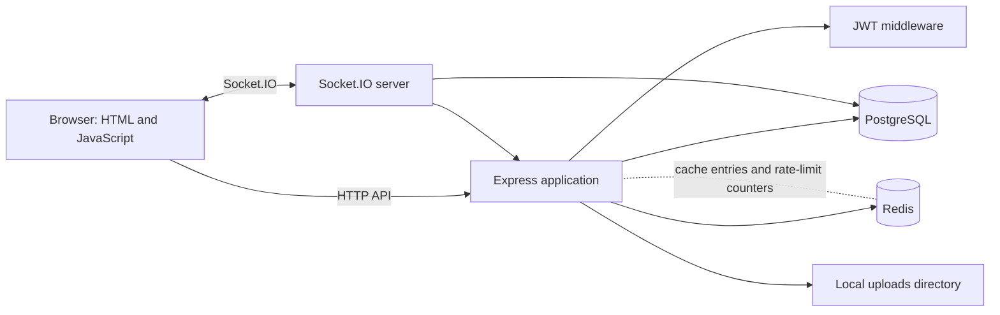

# NitrklShare

NitrklShare is a full-stack social sharing application. Users can publish text and media posts, browse a ranked feed, search for content, like and comment on posts, and view user profiles. The application combines a conventional HTTP API with Redis-backed caching and rate limits, plus Socket.IO events for live updates.

This README is written as a technical project walkthrough: it describes the architecture, request flows, design decisions, operational setup, and current trade-offs.

## Project summary

| Area | Implementation |
| --- | --- |
| Browser UI | HTML, CSS, and vanilla JavaScript |
| HTTP server | Node.js and Express |
| Persistent application data | PostgreSQL through the `pg` connection pool |
| Short-lived cache and rate-limit counters | Redis |
| Live updates | Socket.IO attached to the Express HTTP server |
| Authentication | JWT for HTTP APIs and authenticated socket connections |
| Password storage | bcrypt password hashes |
| Media | Multer writes uploads to local directories |

## Features

- Registration and login with input validation and password hashing
- JWT-protected profile, post, like, and comment operations
- Feed pagination, ordered by like count and then creation time
- Search by title, description, and text content with relevance scoring
- Redis cache-aside behavior for public feed and search responses
- Redis-backed request limits shared across application processes using the same Redis instance
- Live comment and like-count updates for users viewing a post
- Live toast notifications to connected post owners when another user likes or comments
- Local upload handling for images, video, audio, and PDF files

## Architecture



The Express application serves the static files in `public/` and the JSON API from the same origin. Socket.IO shares the underlying HTTP server, so the browser uses the same host and port for both HTTP requests and real-time communication.

### Responsibilities by component

- **PostgreSQL** is the source of truth for users, posts, likes, and comments.
- **Redis** stores temporary copies of public feed/search results and API rate-limit counters. It does not replace PostgreSQL.
- **Socket.IO** delivers events to currently connected browsers. It does not persist comments, likes, or notifications.
- **Express routes** validate requests, enforce authentication where required, perform database operations, and emit socket events after writes succeed.
- **The browser** uses the HTTP API for durable reads and writes, then applies Socket.IO events to update the visible post detail, feed counters, or notification toast.

## Key request flows

### Login and authenticated API calls

1. The browser submits credentials to `POST /api/auth/login`.
2. The server loads the account from PostgreSQL and checks the password hash with bcrypt.
3. The server signs a JWT that expires after seven days and returns it to the browser.
4. The browser stores the token in local storage and sends it as `Authorization: Bearer <token>` on protected API calls.
5. The Express authentication middleware verifies the signature and attaches the user ID to the request.

The Socket.IO client sends the same token during its handshake. The server verifies it and derives the private notification room from the verified user ID; the client cannot choose another user’s room.

### Public feed and search caching

The public feed and public search routes use a cache-aside pattern:

1. Build a Redis key from the request parameters.
2. If Redis has a cached JSON response, return it.
3. Otherwise, query PostgreSQL, build the response, write the JSON to Redis with a TTL, and return it.

Current TTLs are 30 seconds for public feed pages and 60 seconds for public search results. Authenticated feed/search requests bypass the cache because `liked_by_user` depends on the current viewer.

The current implementation relies on TTL expiration rather than explicit cache invalidation. A public result can therefore remain stale until its TTL expires after a post, like, comment, or profile change.

### Rate limiting

The API-wide limiter allows up to 100 requests per IP address in a 15-minute window. The `/api/auth` route group has an additional limit of 10 requests per IP in the same window. `rate-limit-redis` stores the counters in Redis so that multiple processes using the same Redis service share the counters.

The authentication limiter applies to the entire `/api/auth` route group, including profile reads and updates, not only login and registration.

### Live comments, likes, and notifications

The HTTP API remains responsible for writing data to PostgreSQL. Socket.IO sends updates only after those writes succeed:

1. A browser viewing a post joins a `post:<postId>` room. The server checks that the post exists before accepting the room join.
2. When a comment is saved, the server emits `post:comment:new` to the post room with the comment and new comment count.
3. When a like or unlike is saved, the server emits `post:like-count` with the updated count.
4. If the post owner is a different user, the server emits `notification:new` to the owner’s private `user:<userId>` room.

Guests can join public post rooms to receive public post updates. Only sockets with a valid JWT join a private user room. A socket tracks one active post room at a time and leaves the previous room when it joins another.

Notifications are currently transient and only reach connected clients. A notification history or unread count would require a PostgreSQL notifications table and corresponding API routes.

## Data model

The active API routes expect these PostgreSQL tables:

| Table | Main data |
| --- | --- |
| `users` | UUID, username, email, password hash, display name, bio, avatar URL, creation time |
| `posts` | UUID, author ID, title, description, content type/text, media and thumbnail URLs, like/comment counts, creation time |
| `likes` | UUID, user ID, post ID, creation time |
| `comments` | UUID, user ID, post ID, comment text, creation time |

The application uses parameterized SQL queries through `pg`. The current server startup does not run migrations or create these tables automatically. Provision the schema before starting the application.

### Feed and search behavior

- The feed sorts by `like_count` descending, then `created_at` descending.
- Feed page size defaults to 20 and is capped at 50.
- Search checks title, description, and content text with case-insensitive matching.
- Search relevance assigns 3 points for a title match, 2 for a description match, and 1 for a content-text match. Ties are ordered by like count and then creation time.
- Search returns 20 results per page.

## Real-time event contract

| Event | Direction | Payload fields used by the browser | Result |
| --- | --- | --- | --- |
| `post:join` | Browser → server | `postId` | Join a checked public post room |
| `post:leave` | Browser → server | `postId` | Leave the current post room |
| `post:comment:new` | Server → post room | `postId`, `comment`, `commentCount` | Append comment and update count |
| `post:like-count` | Server → post room | `postId`, `likeCount` | Update visible like counts |
| `notification:new` | Server → owner room | `type`, `postId`, `message` | Show a toast notification |

## Project layout

```text
sharewebsite/
├── public/                     # Pages, styles, and browser JavaScript
├── server/
│   ├── index.js                # Express and HTTP server startup
│   ├── db-postgres.js          # PostgreSQL connection pool
│   ├── db.js                   # Legacy NeDB storage module
│   ├── redis.js                # Redis client
│   ├── cache.js                # Redis JSON cache helpers
│   ├── socket.js               # Socket.IO setup, JWT auth, and post rooms
│   ├── middleware/
│   │   ├── auth.js             # JWT route authentication
│   │   ├── errorHandler.js     # Express error handling
│   │   └── rateLimiters.js     # Redis-backed API rate limits
│   └── routes/
│       ├── auth.js             # Registration, login, and profile routes
│       ├── posts.js            # Posts, likes, comments, and socket events
│       └── search.js           # PostgreSQL search and result caching
├── uploads/                    # Runtime media and avatar uploads
├── package.json
└── README.md
```

`server/db.js` is a legacy NeDB module. The active authentication, post, and search routes use PostgreSQL through `server/db-postgres.js`.

## Run locally

### Prerequisites

- Node.js and npm
- PostgreSQL with the required tables provisioned
- Redis available at the configured URL

On macOS with Homebrew, install and start Redis with:

```bash
brew install redis
brew services start redis
redis-cli ping
```

The ping command should return `PONG`.

### Install and configure

Install dependencies:

```bash
npm install
```

Create a private `.env` file in the project root. Use values for your local services:

```dotenv
PORT=3000
JWT_SECRET=replace-with-a-long-random-secret
DB_USER=your-postgres-user
DB_HOST=127.0.0.1
DB_NAME=your-database-name
DB_PASSWORD=your-postgres-password
DB_PORT=5432
REDIS_URL=redis://127.0.0.1:6379
MAX_FILE_SIZE=52428800
```

`MAX_FILE_SIZE` is optional; the default limit is 50 MiB. Never commit or share real credentials or JWT secrets. Production secrets should be configured in the hosting provider’s environment settings.

Start the application:

```bash
npm start
```

For development with automatic restarts:

```bash
npm run dev
```

Open [http://localhost:3000](http://localhost:3000), or the configured `PORT`.

## API overview

### Authentication and profiles

| Method | Path | Purpose | Auth |
| --- | --- | --- | --- |
| `POST` | `/api/auth/register` | Create an account | No |
| `POST` | `/api/auth/login` | Log in and receive a JWT | No |
| `GET` | `/api/auth/me` | Get the current user and post statistics | Yes |
| `GET` | `/api/auth/user/:username` | Get a public user profile | No |
| `PUT` | `/api/auth/profile` | Update the current user’s profile/avatar | Yes |

### Posts, likes, and comments

| Method | Path | Purpose | Auth |
| --- | --- | --- | --- |
| `POST` | `/api/posts` | Create a post, optionally with media | Yes |
| `GET` | `/api/posts/feed?page=1&limit=20` | Get a ranked feed page | Optional |
| `GET` | `/api/posts/:id` | Get a post with author and viewer like state | Optional |
| `GET` | `/api/posts/user/:username?page=1` | Get a user’s posts | Optional |
| `DELETE` | `/api/posts/:id` | Delete the current user’s post | Yes |
| `POST` | `/api/posts/:id/like` | Toggle a like | Yes |
| `GET` | `/api/posts/:id/comments` | Get comments for a post | No |
| `POST` | `/api/posts/:id/comments` | Add a comment | Yes |

### Search

| Method | Path | Purpose | Auth |
| --- | --- | --- | --- |
| `GET` | `/api/search?q=keyword&page=1` | Search posts by title, description, or content | Optional |

## Deployment considerations

The application can run as one Node web service that serves both the frontend and API. A deployment needs:

1. A host that supports long-lived WebSocket connections for Socket.IO.
2. A PostgreSQL instance with the schema already provisioned.
3. A Redis instance reachable through `REDIS_URL`.
4. Environment values for `JWT_SECRET`, `DB_USER`, `DB_HOST`, `DB_NAME`, `DB_PASSWORD`, `DB_PORT`, and `REDIS_URL`.
5. Persistent storage for user uploads.

The current upload implementation writes to the application’s local filesystem. Many hosts clear that filesystem during restarts or deploys, so use a persistent disk or object storage before relying on uploaded files in production.

The current Socket.IO room adapter keeps room membership in process memory. A single server instance is supported by this setup. For multiple instances, configure a shared Socket.IO adapter (for example, a Redis adapter) so events can reach sockets connected to other instances. Shared object storage is also needed if multiple instances serve uploaded files.

## Security and reliability notes

- Passwords are hashed with bcrypt before storage.
- SQL values are passed as query parameters rather than concatenated into SQL strings.
- Protected HTTP routes verify JWTs.
- Socket.IO private rooms are derived from verified JWT claims.
- Rate-limit counts are stored in Redis; cache entries have explicit TTLs.
- The current socket notifications are not durable; offline users miss them.
- The current feed and search caches can be stale until their TTL expires.
- The PostgreSQL schema is not managed by migrations in the current project; add migrations before maintaining the schema across environments.
- Local upload storage is suitable for development, but should be replaced or made persistent for production.

## Interview discussion points

### Short project pitch

> NitrklShare is a social sharing application built with Express and PostgreSQL. The browser uses JWT-authenticated HTTP APIs for durable operations, Redis for short-lived public feed/search caching and shared rate limits, and Socket.IO rooms for live comments, like counts, and online notifications. PostgreSQL remains the source of truth, while Redis and sockets improve response time and responsiveness.

### Why use both PostgreSQL and Redis?

PostgreSQL stores durable relational data and supports joins among users, posts, likes, and comments. Redis is used for short-lived values and counters that are inexpensive to reconstruct: cached public responses and rate-limit counts. A cache miss falls back to PostgreSQL, and the cache entry expires after its TTL.

### Why cache only public feed and search responses?

Authenticated results include `liked_by_user`, which varies by viewer. Sharing a cached personalized response could show one user another user’s like state. The current implementation therefore caches only unauthenticated responses.

### Why use Socket.IO in addition to HTTP?

HTTP is still used to create and retrieve durable records. Socket.IO is used to tell already-connected browsers about a successful change without polling or refreshing. Post rooms limit comment and like updates to viewers of that post, while user rooms target notifications to the post owner.

### How could this scale further?

The next steps would be database migrations and stronger integrity constraints, transactions for multi-query like/comment operations, explicit cache invalidation, persistent notifications, object storage for uploads, and a shared Socket.IO adapter for multiple app instances. For higher search volume, PostgreSQL indexes or a dedicated search service could replace broad `ILIKE` scans.

## Future improvements

- Add database migrations and document the schema in version control.
- Add uniqueness constraints for `(user_id, post_id)` likes and indexes for common feed/search queries.
- Use transactions to keep related record and counter updates consistent under concurrent requests.
- Invalidate or version feed/search cache entries after writes instead of waiting only for TTL expiration.
- Persist notifications and add unread/read state.
- Move uploaded media to object storage.
- Configure a shared Socket.IO adapter before running more than one application instance.
- Add automated route and real-time integration tests.
